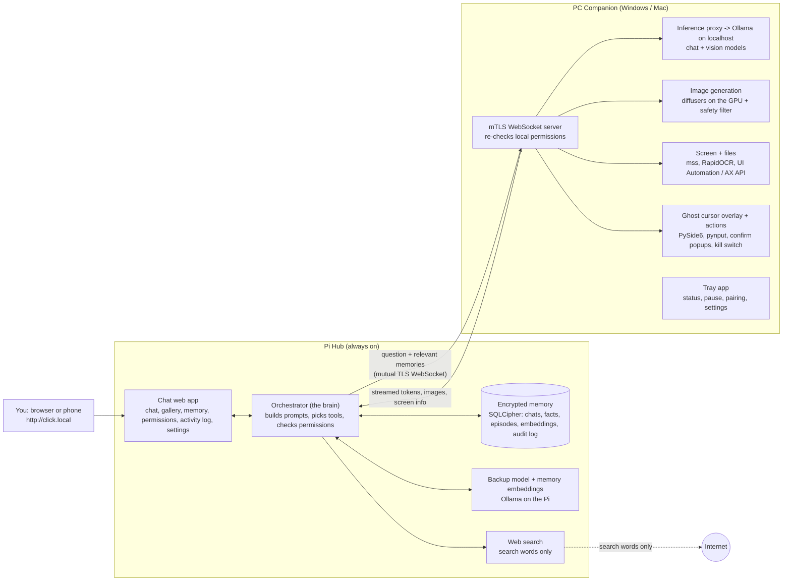

# Click architecture

Click is a private AI assistant that lives on a Raspberry Pi (the **Pi Hub**) and borrows the
power of your Windows or Mac computer (the **PC Companion**).

A Pi can't use another computer's RAM directly, so Click uses "remote inference": the PC runs the
big AI models in its own RAM and GPU, and the Pi sends it each request. Your memories, chats and
settings live only on the Pi. The PC holds them only for the length of one request.



## Request lifecycle (implemented in `pi-hub/app/orchestrator.py`)

1. You type a message in the chat, served by the Pi over a WebSocket.
2. The Pi recalls relevant memories: the core profile plus a vector search of facts, episodes,
   past messages and files, ranked by meaning, recency and importance within a token budget.
   With watch mode on, it also adds the latest screen summary.
3. The Pi assembles the prompt (personality, memories, tool rules, last image) and sends it to the
   PC's chat model.
4. The PC streams tokens back. The Pi streams them to the chat.
5. If the model calls a tool, the Pi first checks the permission toggle, then asks you in the chat
   if needed, logs it, and forwards it to the PC. The PC re-checks its own permissions and the
   blocklist, and for real clicks or typing shows a popup near the target. Up to 6 tool rounds
   per answer.
6. After the reply, a background step extracts new facts about you as JSON, removes duplicates,
   resolves contradictions while keeping history, and indexes the messages for search. Every 12
   messages, and when you start a new chat, it writes an episode summary.
7. If the PC is unreachable before or during an answer, the Pi's backup model answers and the chat
   says so.

## Components

| Folder | What lives there |
|---|---|
| `pi-hub/app/main.py` | FastAPI app: chat WebSocket, REST API for panels, login, pairing, watch mode and weekly memory tidy-up loops |
| `pi-hub/app/orchestrator.py` | The agent loop described above |
| `pi-hub/app/tools.py` | Tool definitions (JSON schemas) and their permission-checked execution |
| `pi-hub/app/memory.py` | Four memory layers, sensitive-data filter, extraction, recall, consolidation |
| `pi-hub/app/pc_link.py` | mDNS discovery, pairing codes, mutual-TLS WebSocket client, heartbeat |
| `pi-hub/app/images.py` | Image jobs, gallery, offline queue, regenerate |
| `pi-hub/app/permissions.py` | Toggles, risk levels, chat confirmations |
| `pi-hub/app/static/` | The chat app (plain HTML/CSS/JS; markdown, sanitizing and code highlighting libraries bundled locally) |
| `pc-companion/companion/server.py` | mTLS WebSocket server, mDNS announcement, request routing and local permission re-check |
| `pc-companion/companion/gui.py` | Ghost cursor overlay (one per monitor), highlights, indicators, confirm popup, tray, settings |
| `pc-companion/companion/actions.py` | Ghost tools, real clicks/typing/keys/scroll, teach mode, kill switch handling |
| `pc-companion/companion/screen.py` | Screenshots with blocklisted windows blacked out, OCR, windows, UI elements |
| `pc-companion/companion/platforms/` | `windows.py` (Win32 + UI Automation), `macos.py` (Quartz + Accessibility API) behind one interface |
| `pc-companion/companion/imagegen.py` | diffusers pipelines (draft and quality), image-to-image, progress, cancel, safety classifier |
| `pc-companion/companion/hardware.py` | Hardware detection and model choice per tier |
| `shared/click_protocol/` | Message envelope and TLS helpers used by both sides |

## Pi to PC protocol

- **Discovery:** the PC announces `_click._tcp` with mDNS, with its id in the TXT record. The Pi
  falls back to the last known IP address, or `manual_pc_host` in `pi-hub/config/click.yaml`.
- **Pairing:**
  1. The chat shows a 6-digit code (valid 10 minutes, 5 tries).
  2. You type it into the tray app, which posts its certificate to `/api/pair/complete` on the Pi.
  3. The Pi returns its own certificate.
  4. From then on both sides pin each other's certificate (mutual TLS). Unpaired devices fail the
     TLS handshake.
- **Transport:** one WebSocket (`wss://pc:47321/click`) carries requests, stream chunks, responses,
  errors and events. Images and screenshots travel base64-encoded on the same channel (limit
  32 MB).
- **Inference:** Ollama on the PC listens only on localhost. The Companion proxies it.
- **Heartbeat:** the Pi sends one every 5 seconds. After 15 seconds without an answer it marks the
  PC offline and uses the backup model.
- **Capability report:** sent at connect (`system.hello`) and again when settings change
  (`system.capabilities` event). It includes the OS, RAM, GPU and VRAM, tier, models, image status
  and services.
- **Message format** (`shared/schema/message.schema.json`):

```json
{
  "id": "uuid",
  "type": "request | response | event | stream_chunk | error",
  "service": "inference | image | screen | cursor | files | system",
  "action": "chat | describe | generate | capture | ocr | move | click | read_file | heartbeat | ...",
  "payload": {},
  "requires_confirmation": false,
  "timestamp": "ISO-8601"
}
```

### Actions

| Service | Actions |
|---|---|
| system | `hello`, `heartbeat`; events `settings` (Pi→PC), `pause` (both directions), `kill` (PC→Pi), `capabilities` (PC→Pi) |
| inference | `chat` (streams `{token}` chunks, final `{model, tool_calls}`), `describe` (vision) |
| image | `generate` (streams `{step,total,status}`, final `{png_b64, seed, model, ...}`), `cancel` |
| screen | `capture`, `ocr`, `list_windows`, `get_active_window`, `get_ui_elements`, `find_ui_element` |
| cursor | `move`, `highlight`, `inspect`, `hide`, `teach_step`, `click`, `type_text`, `press_keys`, `scroll` |
| files | `list_folder`, `read_file`, `search_files`, `rename_file`, `move_file` |

## Coordinates

Every coordinate is a **screen coordinate**, the system mss and the OS input APIs use: physical
pixels on Windows (the process is DPI-aware) and points on macOS. UI elements come from
UI Automation or the Accessibility API in the same system. The overlay maps each Qt screen to its
mss monitor (`gui.match_screens`) and converts with a per-monitor scale, so the ghost cursor lines
up at 100%, 125% and 150% scaling and across several monitors.

## Ports

| Where | Port | Open to |
|---|---|---|
| Pi | 80 (chat + pairing) | Home network only (ufw firewall); chat needs the Click password |
| Pi | 22 (SSH) | Home network only |
| Pi | 11434 (Ollama) | The Pi itself only |
| PC | 47321 (Companion) | Paired Pi only (mutual TLS); Windows firewall rule for private networks |
| PC | 11434 (Ollama) | The PC itself only |

On the Pi, private data lives in `/var/lib/click` and the key in `/etc/click` (root only), separate
from the code, so updates never touch your memories.
